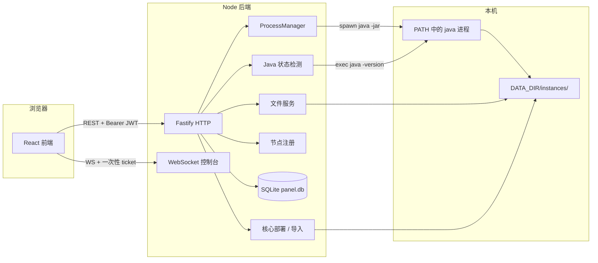

# 架构设计

## 总体架构



核心边界是：实例唯一工作目录为 `DATA_DIR/instances/<id>`。`DATA_DIR` 可相对于项目根目录配置，也可使用绝对路径；实例服务、文件服务、部署和导入都只解析这个托管根目录。不存在用户可指定的安装目录，也不存在面向整台机器的目录浏览能力。所有服务端进程都通过 PATH 中的 `java` 启动。

当前为多机扩展**阶段一**：内置本机节点 `local` 承担全部执行；远程节点创建与 Agent 连接尚未开放（由共享常量 `REMOTE_NODE_CREATION_ENABLED` 控制）。

## Monorepo 布局

| 包名 | 路径 | 职责 |
|------|------|------|
| `@mmd/shared` | `packages/shared` | 共享类型与接口定义 |
| `@mmd/server` | `apps/server` | API、进程、文件、部署 |
| `@mmd/web` | `apps/web` | 管理面板 UI |

根 `package.json` 通过 npm workspaces 聚合 `apps/*` 与 `packages/*`。

## 后端模块

### 入口 `apps/server/src/index.ts`

- 注册 CORS、JWT、multipart、WebSocket、静态资源。
- 挂载路由：`auth`、`instances`、`files`、`cores`、`console`、`system`、`nodes`。
- 健康检查：`GET /api/health`。

### 路由层 `apps/server/src/routes/`

| 文件 | 前缀 / 路径 | 功能 |
|------|-------------|------|
| `auth.ts` | `/api/auth/*` | 初始化、登录、当前用户 |
| `instances.ts` | `/api/instances/*` | CRUD、接管、启停、控制台命令 |
| `files.ts` | `/api/instances/:id/files/*` | 实例根目录内的文件与 `server.properties` |
| `cores.ts` | `/api/cores/*`、`/api/import` | 版本列表、部署、导入 |
| `console.ts` | `/api/instances/:id/console-ticket`、`/ws/console/:id` | 控制台 ticket 与 WebSocket |
| `system.ts` | `/api/system/java` | PATH `java` 状态检测 |
| `nodes.ts` | `/api/nodes/*` | 本机/远程节点列表与管理（阶段一） |

除 `auth/status`、`auth/setup`、`auth/login` 与健康检查外，业务路由经 `authenticate` 校验 JWT。`auth/setup` 另需 `X-Setup-Token`，且只在用户表为空时有效。

### 服务层 `apps/server/src/services/`

| 服务 | 说明 |
|------|------|
| `auth-service` | bcrypt 密码、单用户 setup |
| `instance-service` | 实例 CRUD、托管目录接管，与 DB 同步 |
| `process-manager` | 使用 PATH `java` 的 `spawn`、缓冲输出、启停重启 |
| `file-service` | 实例根目录路径规范化、防目录逃逸 |
| `config-service` | `server.properties` 解析与写入 |
| `core-depot` | Vanilla / Paper / Fabric 下载与部署任务 |
| `import-service` | zip 解压导入到托管实例目录 |
| `task-service` | 异步任务状态与进度 |
| `java-detect` | 执行 `java -version` 并返回可用状态与版本 |
| `node-service` | 节点 CRUD、密钥哈希；远程创建受 `REMOTE_NODE_CREATION_ENABLED` 控制 |
| `node-registry` | 节点在线态 / 心跳（内存；Agent 接入前本机恒为 online） |

### 数据层 `apps/server/src/db.ts`

SQLite 表：

- `users` — 管理员
- `instances` — 实例元数据、jar、JVM 参数、托管状态、`node_id` 等
- `tasks` — 部署 / 导入任务
- `nodes` — 执行节点元数据与密钥哈希（含内置 `local`）

使用 `node:sqlite` 的 `DatabaseSync`，WAL 模式。实例文件不存入数据库，统一位于 `DATA_DIR/instances/<id>`。

## 实例目录与安全边界

默认数据结构：

```text
DATA_DIR/
├── panel.db
├── instances/
│   └── <id>/
├── cache/cores/
└── uploads/
```

`defaultInstanceDir(id)` 将实例 ID 解析为 `DATA_DIR/instances/<id>`；文件读写和进程工作目录都必须经过实例根目录校验。文件 API 接收的 `path` 是相对实例根目录的逻辑路径，并拒绝 `..` 逃逸。

### 旧版外部实例接管

历史记录可能保留旧版外部目录的迁移状态。面板不会读取、扫描、搬迁或删除该外部目录。用户必须先停止实例和面板服务，用系统工具将完整目录复制到 `DATA_DIR/instances/<id>`，再通过 `POST /api/instances/:id/adopt-managed-directory` 或界面 **接管**。接管只确认并登记面板托管副本；面板不会自动操作旧位置。

## 进程模型

`ProcessManager` 对每个实例维护：

- 子进程引用
- 状态（与前端 `InstanceStatus` 一致）
- 受 `MAX_CONSOLE_BUFFER_BYTES` 限制的环形文本缓冲

普通 jar 的启动命令形态：

```text
java <jvmArgs...> -jar <jarFile> nogui
```

工作目录固定为 `DATA_DIR/instances/<id>`。`java` 由运行面板的进程环境通过 PATH 解析，数据库和请求均不能替换为其他可执行路径。

## 前端结构

| 路径 | 说明 |
|------|------|
| `src/App.tsx` | 路由与侧栏布局 |
| `src/auth.tsx` | 登录态、setup 检测 |
| `src/api.ts` | `fetch` 封装、任务轮询 |
| `src/pages/*` | 各功能页 |
| `src/components/ConsolePanel.tsx` | xterm + WebSocket |

路由表：

- `/login` — 登录 / 初始化
- `/` — 实例总览
- `/deploy` — 一键部署
- `/import` — zip 导入
- `/nodes` — 节点管理（当前以本机节点为主）
- `/instances/:id/*` — 实例详情 Tab

## 认证流程

1. `GET /api/auth/status` → `needsSetup`。
2. 若需 setup：`POST /api/auth/setup`，携带 `X-Setup-Token: <SETUP_TOKEN>` → `{ token, user }`。
3. `setup` 只在用户表为空时接受；管理员创建后可以移除 `SETUP_TOKEN`。
4. 否则：`POST /api/auth/login` → `{ token, user }`。
5. 后续 HTTP 请求：`Authorization: Bearer <token>`。
6. 控制台先用 JWT 获取一次性 ticket，再通过 WebSocket query `ticket` 连接。

## 外部依赖 API

| 用途 | 来源 |
|------|------|
| Vanilla 版本与 jar | Mojang 官方元数据 |
| Paper build | `fill.papermc.io` v3 |
| Fabric loader / installer | Fabric Meta API |
| Forge / NeoForge | BMCLAPI2 版本列表 + Maven Installer，`--installServer` |

下载文件可缓存在 `DATA_DIR/cache/cores/` 以减少重复拉取；下载大小和超时受对应环境变量限制。

核心缓存下载先写入临时文件，完整下载并通过校验后才原子发布到最终缓存路径，失败、取消或超时不会留下可复用的部分文件。部署 / 导入任务由并发槽位和等待队列调度，队列满时拒绝新任务；任务执行超过配置的超时会被取消，Installer 结束时先等待 `INSTALLER_KILL_GRACE_MS` 再强制结束。

HTTP 请求与上传还有总请求、连接、keep-alive 和上传空闲超时。上传大小超限返回 413，上传并发容量或任务队列耗尽返回 429。实例文件下载受 `MAX_CONCURRENT_FILE_DOWNLOADS=4` 并发槽位限制，容量耗尽返回 429；`FILE_DOWNLOAD_IDLE_TIMEOUT_MS=60000` 空闲超时会关闭下载并释放槽位。控制台 transport、并发连接、命令速率、stdin 待处理输入和历史输出均有独立字节 / 数量上限。

## 类型共享

`packages/shared/src/index.ts` 导出 `InstanceInfo`、`DeployCoreInput`、`TaskInfo`、`ConsoleMessage`、`NodeInfo` 等类型，以及请求体 JSON Schema（如 `createInstanceBodySchema`），供 Fastify AJV 与 TypeScript 契约共用，减少路由内双写漂移。

构建顺序：**必须先构建 `@mmd/shared`**，再构建 server / web。独立类型检查：`npm run typecheck`。
