# Minecraft Mystry Dashboard 产品介绍

**版本**：`0.2.0-preview.1`  
**形态**：单机一体的 Minecraft **Java 服务端** Web 管理面板  
**不是**：游戏客户端、Fabric/Forge 模组、远程多机 Agent 控制台  

配套 PDF：[`Mystry-Dashboard-产品介绍.pdf`](Mystry-Dashboard-产品介绍.pdf)（重新生成：`python docs/product-intro/build-pdf.py`）  
操作步骤见 [使用指南](../user-guide.md) 与 [分步教程](../tutorials.md)。本文用真实界面截图说明每个页面和每个按钮做什么。

截图拍摄于本机开发界面（Vite 开发服务器，Mystry 暗色主题；登录页另有亮色）。图中的示例实例「生存服」（一键部署的 Paper 1.21.11，运行中）、「已有服务器」（同机目录交接导入）、「自定义 Jar 实例」（创建空实例），以及任务时间、主机指标和 Java 21 版本均来自拍摄时的临时本机数据，不是产品内置示例服。

---

## 1. 产品是什么

Mystry Dashboard 跑在你自己的电脑上。用浏览器管理本机上的多个 Minecraft Java **服务端**进程：下载或导入核心、启动/停止 Java、看实时日志、改 `server.properties`、在实例目录里管文件。

```
浏览器  →  面板 Web（React）  →  本机 API（Fastify + SQLite）
                                      ├─ 启动/停止 Java 进程
                                      ├─ 读写 DATA_DIR/instances/<id>
                                      └─ 部署 / 导入后台任务
```

默认访问：

| 模式 | 地址 |
|------|------|
| 开发（Vite） | `http://127.0.0.1:5173` |
| 生产 / 便携包 | `http://127.0.0.1:3000` |

默认只监听本机回环地址，外网不能直接打开。

### 能做

- 多实例列表：启动、停止、重启、强制停止、删除
- 一键部署 Vanilla / Paper / Fabric / Forge / NeoForge
- 从 `DATA_DIR/imports/<目录名>` 交接已有服务端，或上传 ZIP（先预检再导入）
- 创建空目录后自己上传 `server.jar`
- 实时控制台（WebSocket + 日志着色）
- 实例目录内：浏览、上传、下载、重命名、文本编辑、删除、新建文件夹
- 引导式编辑 `server.properties`
- 统一 JVM 配置器（内存、预设、附加参数、最终参数预览）
- 扫描并绑定本机 Java 运行时（不能手填可执行路径）
- 任务中心跟踪部署/导入到完成或失败
- 三套主题 × 暗色/亮色

### 明确不做

- 不是 Minecraft 客户端启动器，不启动游戏窗口
- 不浏览整台电脑，不能指定任意安装路径
- 远程节点 / Agent 创建当前关闭，只有内置本机节点 `local`
- 没有多管理员、角色权限、2FA、会话撤销
- 进程重启后，未完成的部署/导入不会续跑（会标为失败）
- 不自动安装 Java

---

## 2. 界面总览

登录后是左右结构：左侧固定导航，右侧顶栏 + 当前页面。窄屏（约 ≤1024px）侧栏收成顶栏抽屉。

```
┌────────────────────┬──────────────────────────────────────────┐
│ Mystry Dashboard   │ 页面标题 [Minecraft Java 服务端]  [任务队列] 🎨 │
│ v0.2.0-preview     ├──────────────────────────────────────────┤
│                    │                                          │
│ 主控集群            │  指标卡片 / 实例卡片 / 表单 / 控制台 / 文件列表 │
│  实例总览           │                                          │
│  当前工作台（详情页） │                                          │
│ 部署与维护          │                                          │
│  一键部署           │                                          │
│  导入服务端         │                                          │
│  节点监控           │                                          │
│                    │                                          │
│ (A) admin  [登出]   │                                          │
└────────────────────┴──────────────────────────────────────────┘
```

| 入口 | 路由 | 作用 |
|------|------|------|
| 实例总览 | `/` | 主机指标与所有实例的状态、快捷操作 |
| 一键部署 | `/deploy` | 从官方源下载核心并创建实例 |
| 导入服务端 | `/import` | 同机目录直接交接，或 ZIP 服务端整合包导入 |
| 节点监控 | `/nodes` | 查看本机节点与运行环境；远程创建未开放 |
| 当前工作台（实例详情） | `/instances/<id>` | 控制台 / 文件管理 / 参数配置 / 实例设置 & JVM |

---

## 3. 登录页

路由：`/login`

未登录、会话失效，或首次尚未创建管理员时进入此页。标题在两种状态间切换：

- **登录面板**：用户表已有管理员
- **初始化管理员**：用户表为空，需要额外填写 64 位 `SETUP_TOKEN`


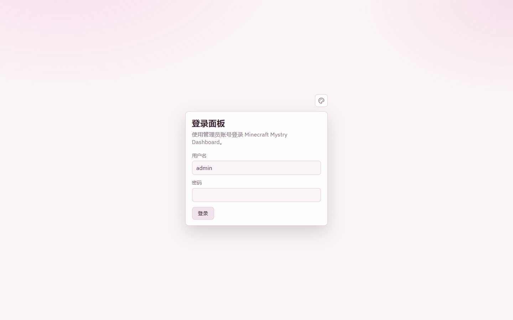

### 控件说明

| 控件 | 类型 | 说明 |
|------|------|------|
| 调色板图标 | 按钮 | 打开主题选择器，选择保存在本浏览器 `localStorage`（键 `mmd_theme`） |
| 用户名 | 文本框 | 默认填 `admin`；初始化时即所创管理员名 |
| 初始化令牌 | 密码框 | **仅首次初始化**出现。必须与服务器 `SETUP_TOKEN` 完全一致（64 位十六进制） |
| 密码 | 密码框 | 日常登录任意非空；初始化要求至少 12 位 |
| **登录** / **创建并进入** | 主按钮 | 提交。处理中显示「处理中…」并锁定，防止连点 |
| 重新检查 | 按钮 | 仅当面板服务连不上时出现，重新请求 `/api/auth/status` |

登录成功后 token 存在本浏览器 `localStorage`（键 `mmd_token`）。任一业务接口返回 401 会清掉登录态并回到本页。

服务不可用时，卡片标题变为「面板服务不可用」，只保留错误信息和「重新检查」。

### 主题选择器（登录页、顶栏共用）


| 控件 | 说明 |
|------|------|
| 调色板按钮 | 展开/收起；`Escape` 关闭 |
| Mystry 暗色 / 亮色 | 产品默认粉紫套装 |
| Codex 暗色 / 亮色 | 暖灰青绿 |
| Grok 暗色 / 亮色 | 近黑或白底高对比 |

未保存过主题时，仅在 Mystry 暗/亮之间跟随系统 `prefers-color-scheme`。控制台终端区域始终保持暗色，不受亮色主题影响。

---

## 4. 全局壳层：侧栏、顶栏、任务中心、登出


### 侧栏

| 控件 | 说明 |
|------|------|
| **Mystry Dashboard** | 品牌名与版本号，不是按钮 |
| **实例总览** | 进入 `/`，当前页高亮 |
| **当前工作台** | 仅在实例详情页出现并高亮 |
| **一键部署** | 进入 `/deploy` |
| **导入服务端** | 进入 `/import` |
| **节点监控** | 进入 `/nodes` |
| 用户名 | 只读，当前登录账号（「本机主控权限」） |
| 登出图标 | 「登出系统」：清除本浏览器 token，回到登录页。不停止正在运行的 Minecraft 进程 |

### 顶栏

| 控件 | 说明 |
|------|------|
| 页面标题 + 「Minecraft Java 服务端」标签 | 只读，随当前页面变化 |
| **任务队列** | 打开右侧任务中心。徽标显示进行中任务数；没有进行中任务时以灰色显示最近任务总数 |
| 调色板 | 打开主题选择器 |
| 菜单图标（窄屏） | 「打开 / 关闭导航菜单」：打开或关闭侧栏抽屉。打开后主内容 `inert`，`Escape` 或点遮罩关闭 |

---

## 5. 任务中心

点顶栏 **任务队列** 打开，从右侧滑出「后台异步任务中心」。离开部署/导入页后，任务仍会轮询到「已完成」或「失败」。页面隐藏时暂停轮询；遇到 429 会退避。

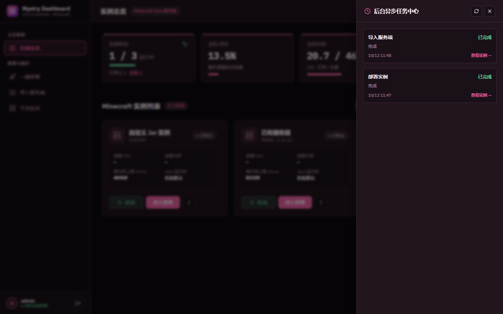

| 控件 / 区域 | 说明 |
|-------------|------|
| 刷新 / 关闭图标 | 立即刷新任务；关闭面板（也可再点任务队列、按 `Escape` 或点面板外） |
| 类型标签 | 下载核心 / 解压文件 / 部署实例 / 导入服务端 |
| 状态徽章 | 排队中、进行中、已完成、失败 |
| 进度条 | 仅排队中、进行中显示，数值限制在 0–100 |
| 错误摘要 | 失败任务显示 `error` |
| **查看实例 →** | 任务结果带 `instanceId` 时出现（成功或失败但已落地均可） |
| 过期提示 | 轮询失败时显示「状态可能已过期」和上次成功同步时间，可点刷新图标重试 |

任务元数据在 SQLite，真正的队列在内存。**重启面板不会续跑**，遗留的 `pending` / `running` 会被标为失败。

---

## 6. 实例总览

路由：`/`  
实例列表约每 3 秒刷新，主机指标约每 5 秒刷新。首次加载有「正在加载实例列表…」；刷新失败时保留上次数据并提示可能已过期。


### 指标卡片

| 卡片 | 说明 |
|------|------|
| 实例状态 | 运行中 / 总数，以及已停止、异常数量；点「异常 N」只看异常实例，再点恢复显示全部 |
| 主机 CPU | 按整机逻辑核总容量计算；首次采样前显示「采集中…」 |
| 主机内存 | 已用 / 总量（GiB） |
| 数据盘空间 | 数据目录所在磁盘的剩余空间 |
| 「更新于 … 刷新」 | 显示最近采样时间，点「刷新」立即重新采样 |

### 页面级按钮

| 控件 | 说明 |
|------|------|
| **一键部署** | 去 `/deploy`，在线选核心。总览固定保留的主入口 |
| **导入服务端** | 去 `/import`，交接目录或上传 ZIP |
| **创建空实例** | 打开创建对话框。次级入口，给自带 server.jar 用 |
| **重新加载** | 仅列表完全加载失败时出现 |

没有任何实例时，列表区显示「暂无 Minecraft 实例」，并提供「立即部署第一台服务端」和「导入已有服务端」两个入口。

### 实例卡片

| 区域 | 说明 |
|------|------|
| 名称 | 点击进入该实例工作台（控制台） |
| 核心 · 版本 | `PAPER` / `FABRIC` / `VANILLA` / `FORGE` / `NEOFORGE` / `CUSTOM`，后接 Minecraft 版本 |
| 状态 | 见下表 |
| 进程 CPU / 进程内存 | 仅进程存活时有值，否则显示「—」 |
| 堆内存上限 (Xmx) / Java 运行时 | 来自实例 JVM 设置；未绑定运行时显示「系统默认」 |
| 底部按钮 | 当前可执行的启动/停止、**进入管理**、「更多操作」（⋮）收纳危险项 |

### 状态徽章

| 显示 | 含义 | 通常可做的 |
|------|------|------------|
| 已停止 | 没有 Java 进程 | 启动、删除 |
| 启动中 | 正在拉起 | 等待；可强制停止 |
| 运行中 | 服务端在跑 | 停止、重启、强制停止；不可删除 |
| 停止中 | 正在结束 | 等待；可强制停止 |
| 已崩溃 | 进程异常退出 | 启动、看控制台 |
| 待迁移 | 旧版外部目录尚未接管 | 只能「接管」或移除记录，不能启停 |

### 行内操作

| 控件 | 何时可点 | 做什么 |
|------|----------|--------|
| **进入管理** | 始终 | 进入 `/instances/<id>` 实例工作台 |
| **启动** | 已停止或已崩溃，且非待迁移 | `POST /api/instances/:id/start`。开始前会占位「启动中」 |
| **停止** | 仅运行中 | 向进程写 `stop`，**不会**隐式强杀。超时仍在停止中时提示可改用强制停止 |
| **更多操作**（⋮） | 始终 | 展开/收起重启实例、强制停止、删除实例 |

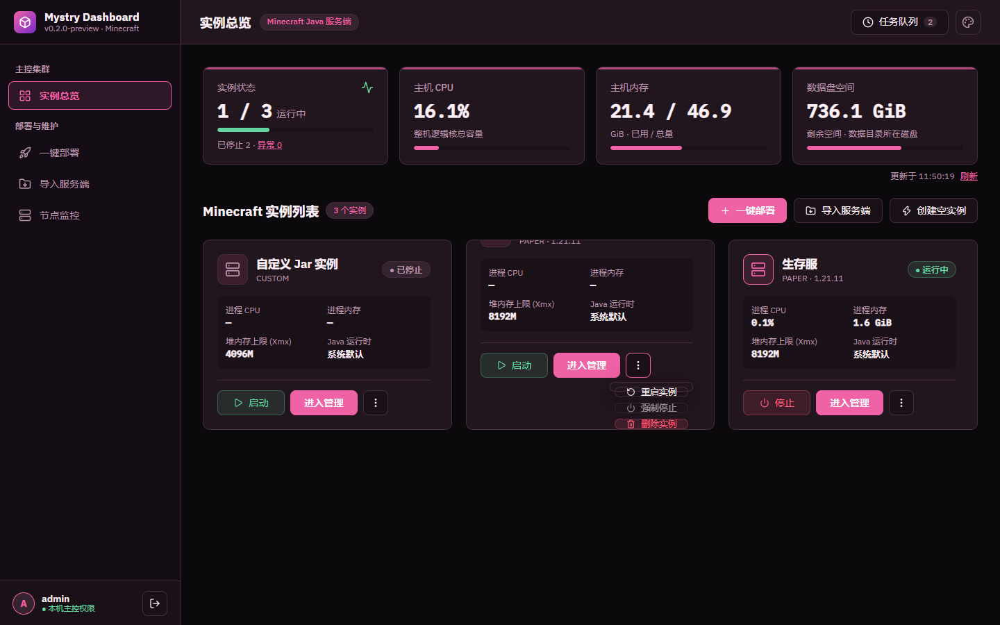

| 更多操作 | 何时可点 | 做什么 |
|----------|----------|--------|
| **重启实例** | 非启动中/停止中 | 打开确认框。先停再启，会踢掉在线玩家 |
| **强制停止** | 运行中 / 启动中 / 停止中 | 打开确认框。对应 `POST .../stop?force=1`，立即结束进程 |
| **删除实例** | 进程未存活（待迁移实例除外） | 打开确认框。运行中禁止删除，按钮提示「实例仍在运行，请先停止后再删除」 |

已停止时「强制停止」会禁用（上图「已有服务器」即此状态）。

> 已知问题：桌面宽度下，「更多操作」菜单目前会被实例卡片裁剪，需要在卡片内向下滚动才能看到全部菜单项（上图即滚动后的样子）；窄屏卡片布局下菜单在卡片内直接展开，不受影响。

### 删除确认


| 控件 | 说明 |
|------|------|
| 确认文本框 | 托管实例必须**原样输入实例名**才能点永久删除 |
| **取消** | 关闭，不改任何数据。执行期间禁用，且禁止 Escape / 点遮罩绕过 |
| **永久删除** | 删除数据库记录和 `instances/<id>` 全部文件，不可恢复 |
| **移除记录** | 仅待迁移实例：只删面板记录，不动旧外部目录 |

### 创建空实例

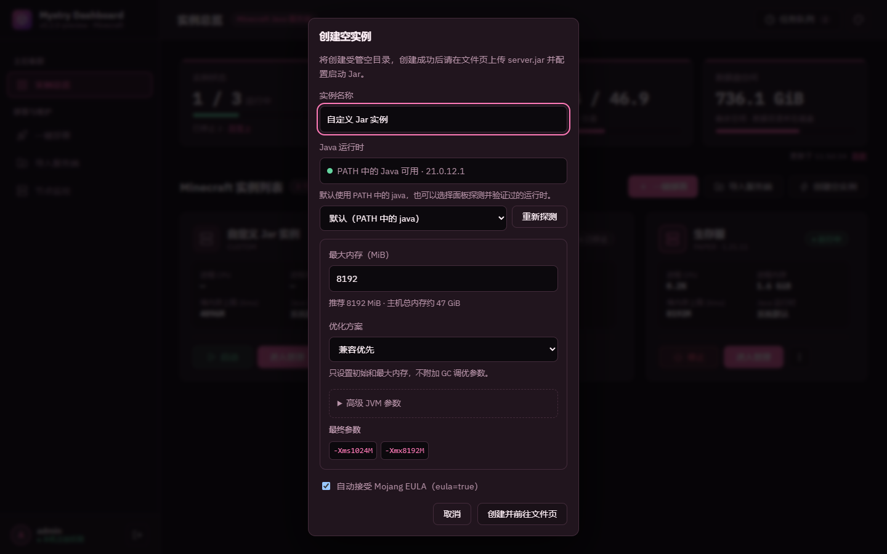

| 控件 | 说明 |
|------|------|
| 实例名称 | 默认「自定义 Jar 实例」 |
| Java 运行时 | 见第 11 节。默认 PATH 中的 `java` |
| **重新探测** | 重新扫描本机 Java 安装 |
| JVM 设置 | 与部署/导入/设置共用同一配置器 |
| 自动接受 Mojang EULA | 勾选后启动时写 `eula=true` |
| **取消** | 关闭，不创建 |
| **创建并前往文件页** | `POST /api/instances`（`coreType=custom`），成功后跳到该实例文件页去上传 Jar。JVM 有错误时禁用 |

---

## 7. 一键部署

路由：`/deploy`

从 Mojang / Paper / Fabric / Forge / NeoForge 拉取文件，在 `DATA_DIR/instances/<新ID>` 创建实例。表单**不能**填写安装路径。

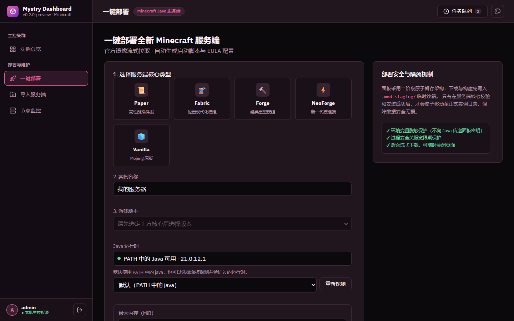

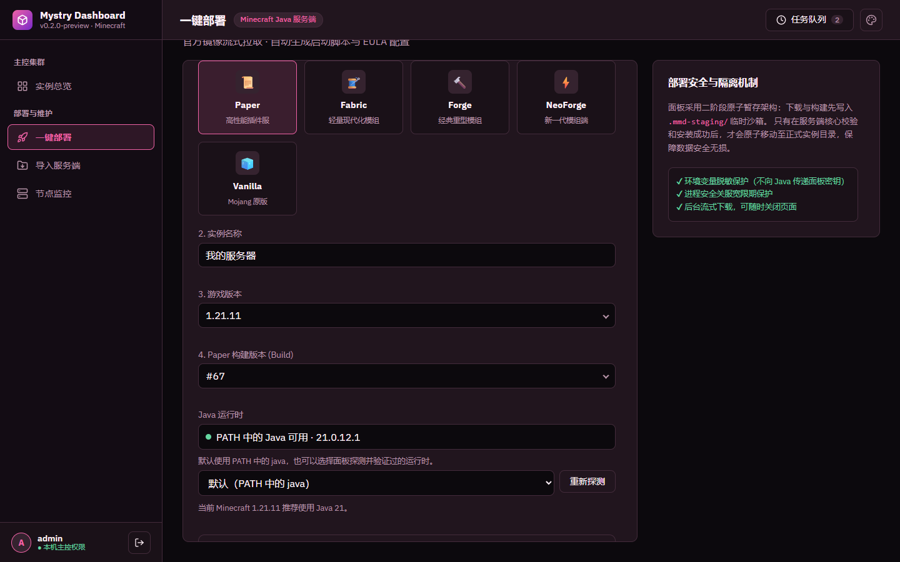

上图选择了 Paper、游戏版本 1.21.11 与最新 Build，并提示「当前 Minecraft 1.21.11 推荐使用 Java 21」。右侧「部署安全与隔离机制」卡片只做说明，不可操作。

### 字段与按钮

| 控件 | 说明 |
|------|------|
| 1. 选择服务端核心类型 | Paper / Fabric / Forge / NeoForge / Vanilla 卡片，点击选中。切换会清空后续版本字段 |
| 2. 实例名称 | 总览里显示的名字，默认「我的服务器」 |
| 3. 游戏版本 | 选定核心后可用；打开下拉时才向官方源拉列表，可滚动加载 |
| 4. Paper 构建版本 (Build) | 仅 Paper。显示为 `#数字` |
| Loader / Forge / NeoForge 版本 | 模组加载器版本 |
| Installer 版本 | 仅 Fabric |
| Java 运行时 + **重新探测** | 见第 11 节。所选运行时用于 Forge/NeoForge Installer 和以后启动 |
| JVM 设置 | 见第 12 节 |
| 我已阅读并同意 Minecraft 最终用户许可协议 (EULA) | 默认勾选，启动时写 `eula=true` |
| **立即开始自动化部署** | 未选齐必填项或 JVM 非法时禁用。提交后锁定表单，文案变「部署任务运行中…」 |
| 进度条 | 显示当前步骤与 0–100%。可离开本页，到任务中心看 |
| **复制错误** | 部署失败后复制摘要 |
| **查看详情** | 错误过长时打开完整错误对话框 |
| **复制全部** / **关闭** | 错误详情对话框内 |

Forge / NeoForge 会下载官方 Installer 并执行 `--installServer`，耗时可能很长。任务可能先显示「排队」；前端会一直等到完成或失败，成功后自动跳到新实例控制台。

达到并发上限会排队；等待队列已满返回 429。开始执行后超过 `TASK_TIMEOUT_MS` 会失败。

---

## 8. 导入已有服务端

路由：`/import`

两种方式都会**再复制一份**到新的 `instances/<id>`，不会让实例在原目录运行，也不会删除源目录。

### 8.1 同机目录直接交接

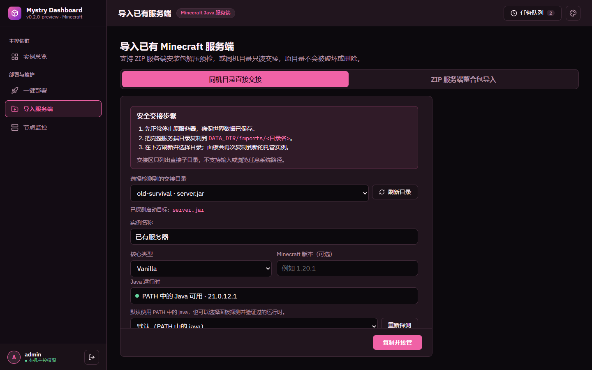

步骤写在页面上：先停原服 → 把完整目录复制到 `DATA_DIR/imports/<目录名>` → 刷新并选择 → 复制并接管。上图交接区里有一个示例目录 `old-survival`，已自动选中并探测到启动目标 `server.jar`。

| 控件 | 说明 |
|------|------|
| **同机目录直接交接** / **ZIP 服务端整合包导入** | 切换导入方式 |
| 选择检测到的交接目录 | 只列出 `imports` 的**直接子目录**，显示为「目录名 · 启动目标」。不可用项会禁用并显示原因 |
| **刷新目录** | 重新扫描交接区 |
| 实例名称、核心类型、Minecraft 版本 | 预检/选中可用目录后出现。核心可选「自动识别 / 自定义」 |
| Java 运行时、JVM、EULA | 与部署相同。若检测到 `user_jvm_args.txt`，必须先选处理方式（见第 12 节） |
| **复制并接管** | 入队后台复制任务。成功后跳转实例页 |

面板不接受系统绝对路径，不提供全盘浏览。复制会拒绝 symlink/junction、特殊文件、面板实例标记、超配额和磁盘不足。

### 8.2 ZIP 服务端整合包导入

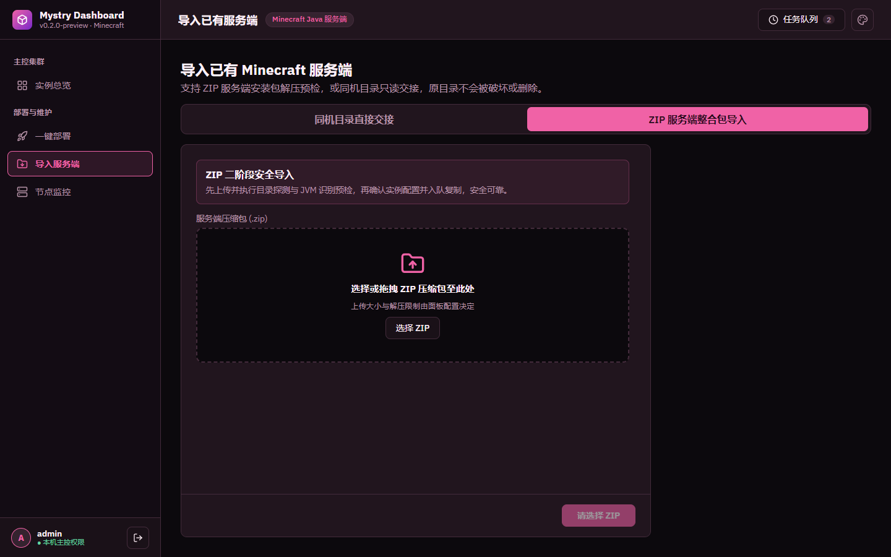

分两步：先上传预检，再确认配置并导入。刷新后同一登录用户会从 `sessionStorage` 恢复未过期预览。

| 控件 | 说明 |
|------|------|
| 服务端压缩包 (.zip) | 拖拽到虚线区域或点 **选择 ZIP**。最大约 512 MiB，还受 ZIP 配额限制。未选文件时底部按钮显示「请选择 ZIP」并禁用 |
| **上传并预检** | 校验中央目录，只读取根目录或单一顶层目录中最大 64 KiB 的 `user_jvm_args.txt` |
| 预检卡片 | 显示文件名、大小、过期时间 |
| **取消并重新选择** | 预检卡片上的按钮。立刻丢掉临时包，不写数据库 |
| **上传并替换预览** | 已有预览时再选新文件 |
| **确认配置并导入** | 预检成功且 JVM 合法后入队。队列满返回 429，预览保留以便重试 |

预览默认 30 分钟、按用户隔离；过期、取消、关面板或重启后需重新上传。

---

## 9. 节点监控

路由：`/nodes`  
约每 5 秒刷新。


本机节点以卡片展示：

| 区域 / 控件 | 说明 |
|-------------|------|
| 节点名与状态 | 「本机节点 (本机内置主控节点)」，右侧徽章显示在线 / 离线；加载失败时显示「状态可能已过期」 |
| 宿主操作系统平台 | 如 `win32` / `linux` |
| CPU 架构 / 核心 | 如 `x64 · 16 线程` |
| 物理内存总量 | 本机内存 |
| 已挂载实例数 | 挂在本机节点上的实例数量 |
| 数据根路径保护 | 说明实例文件限制在面板配置的数据根目录内 |
| 其他节点列表 + **删除** | 仅存在历史远程记录时出现；只有实例数为 0 的远程记录可删，并二次确认 |
| **重试加载** | 列表加载失败时出现 |

当前 `REMOTE_NODE_CREATION_ENABLED = false`，没有「添加远程节点」按钮。页面下方「远程多机分布式集群」卡片写明远程纳管尚未开放。

---

## 10. 实例详情

路由：`/instances/<id>`，页面标题为「实例工作台」，侧栏出现「当前工作台」。四个 Tab：控制台（默认）、文件管理、参数配置、实例设置 & JVM。

顶部卡片在所有 Tab 共用，显示实例名、状态徽章和「核心 · 版本 · 节点」：

| 控件 | 说明 |
|------|------|
| **←**（返回总览） | 回到 `/` |
| **启动** | 已停止或已崩溃时显示 |
| **停止** | 仅运行中显示。普通停止，写 `stop` |
| **重启** | 非启动中/停止中。确认后先停再启 |
| **强制停止** | 运行中/启动中/停止中。确认后 SIGKILL |
| 控制台 / 文件管理 / 参数配置 / 实例设置 & JVM | 切换子页。待迁移实例不显示 Tab，只显示接管面板 |

待迁移时主按钮是 **接管托管目录**：你必须先用系统工具把旧目录复制到 `DATA_DIR/instances/<id>`，再点接管。面板不会读或删旧目录。

### 10.1 控制台

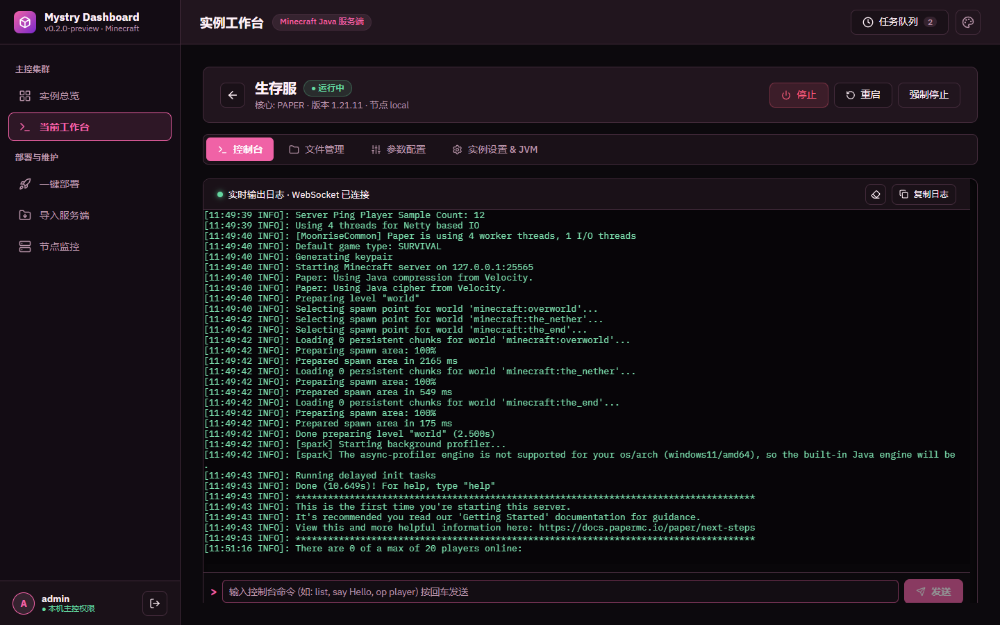

| 控件 | 说明 |
|------|------|
| 状态条 | 「实时输出日志 · WebSocket 已连接」；连接中或实例未运行时相应提示 |
| 清空屏幕 / **复制日志** | 清空本地终端显示（不影响服务端）；复制全部输出 |
| 终端区域 | xterm.js。INFO 绿、WARN 黄、ERROR 红。先回放历史再跟实时输出 |
| 命令输入 | 仅运行中可发送；停止时占位「实例已停止，启动后可发送指令」 |
| **发送** | 把输入发给服务端 stdin，等价回车。支持方向键翻历史 |
| 常用命令快捷键 | 终端下方的 list / save-all / tps / whitelist list / help 按钮，仅可发送时可用 |

上图为运行中的 Paper 1.21.11 示例服：先回放启动日志，最后一行是发送 `list` 后的真实回显。
| 自动重连 | 断线后 1s → 30s 指数退避，重新申请一次性 ticket |

控制台走短期一次性 WebSocket ticket，不是长期 JWT。连接数、单条命令长度和发送频率都有上限。

### 10.2 文件管理

所有路径都是相对**当前实例根目录**的逻辑路径，不是本机资源管理器。

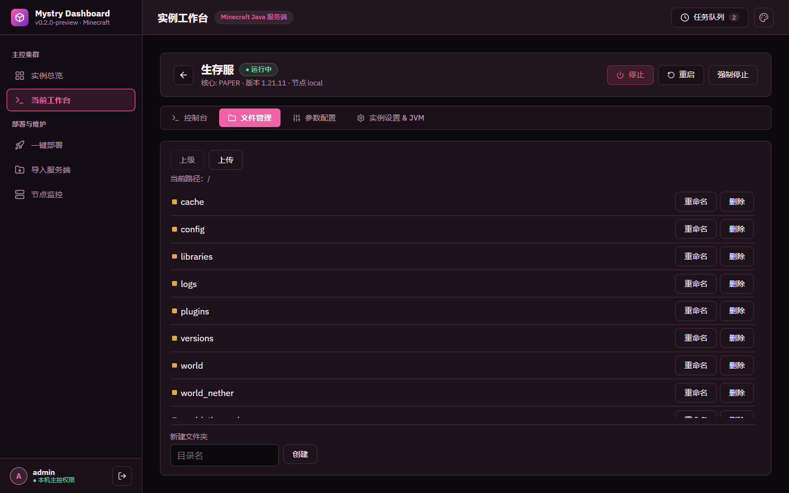


| 控件 | 说明 |
|------|------|
| **上级** | 回到实例内父目录；根目录禁用 |
| **上传** | 把文件传到**当前逻辑目录** |
| 文件夹名 | 点击进入该目录 |
| **下载** | 仅普通文件。一次性 ticket + 浏览器原生下载，不用 `blob()` 整包缓存。并发满了提示「下载繁忙」 |
| **重命名** | 仅同目录改名，不能含 `/` `\`。目标已存在返回 409，不覆盖 |
| **编辑** | 非目录且不超过约 1 MiB 才显示。打开对话框，不自动保存 |
| **删除** | 文件或文件夹。文件夹会递归删除，确认框写明逻辑路径且不可恢复 |
| 新建文件夹 + **创建** | 在当前目录建子目录 |
| 编辑器 **关闭** / **取消** | 丢弃未保存修改 |
| 编辑器 **保存** | 写回磁盘，成功提示「已保存」 |
| **重新读取** | 列表刷新失败时出现 |

改 `mods`、`plugins`、世界数据前建议先停服。

### 10.3 参数配置

编辑 `server.properties`。保存后必须**重启实例**才生效。


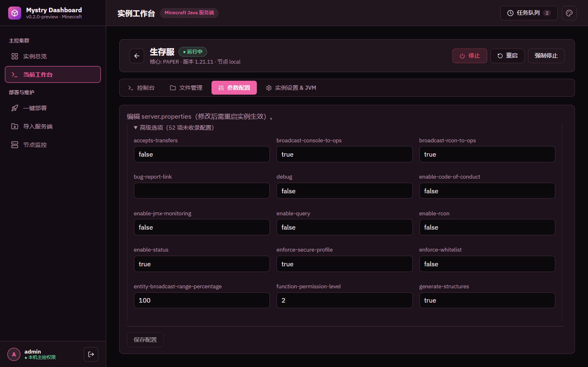

| 分组 | 典型项 |
|------|--------|
| 基础设置 | MOTD、端口、人数、难度、游戏模式、强制模式 |
| 多人与权限 | 正版验证、白名单、PVP、飞行、OP 等级 |
| 世界 | 世界名、种子、下界、刷怪、出生点保护 |
| 性能 | 视距、模拟距离、网络压缩 |
| 高级选项 | 未收录的原始键，仍可改文本 |

| 控件 | 说明 |
|------|------|
| 各输入 / 下拉 / 开关 | 只改该 key 的最后一次定义；服务端保留注释、空行、重复键和 `:` 分隔符 |
| **保存配置** | 无修改或保存中时禁用。成功后提示「已保存，重启实例后生效」 |
| 离开确认 | 有未保存修改时切 Tab 或导航会询问「放弃修改并离开」；关浏览器标签走 `beforeunload` |

### 10.4 实例设置 & JVM

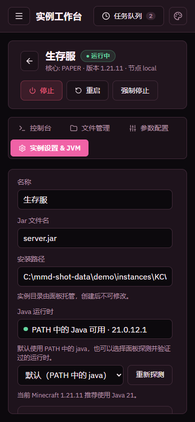

上图为窄屏（390px）下的设置页：顶部按钮与 Tab 自动换行，安装路径显示为示例数据根下的 `instances/<id>`。

| 控件 | 说明 |
|------|------|
| 名称 | 可改 |
| Jar 文件名 | 相对实例目录，如 `server.jar` 或 `forge-1.12.2-….jar` |
| 安装路径 | **只读**，显示 `DATA_DIR/instances/<id>` |
| Java 运行时 + **重新探测** | 绑定已验证运行时，或保持 PATH 默认 |
| JVM 设置 | 与其它入口同一配置器。旧实例非法文本会保持原样，但修正前不能保存或启动 |
| 启动时自动写入 eula=true | 每次启动写 `eula.txt` |
| **保存设置** | 无变化、保存中或 JVM 非法时禁用。成功后页内提示「设置已保存」 |

---

## 11. Java 运行时选择器

出现在：创建空实例、一键部署、导入、实例设置。

| 控件 | 说明 |
|------|------|
| PATH 状态条 | 显示默认 `java` 是否可用及版本 |
| 下拉框 | 「默认（PATH 中的 java）」+ 面板扫描到的条目。不可用项禁用并标「（不可用）」 |
| **重新探测** | 扫描 `JAVA_HOME` 和常见安装目录。候选必须文件名是 `java`/`java.exe`，且 `-version` 可解析 |
| 版本告警 | 已识别 MC 版本时：1.20.5+ 建议 Java 21，1.17–1.20.4 建议 17，更早建议 8。不匹配会黄字警告 |

请求只能提交运行时 **ID**，不能提交可执行路径。启动和 Forge/NeoForge Installer 执行前会再验证一次。子进程环境会脱敏，不把面板密钥或 `DATA_DIR` 传给 Java。

---

## 12. JVM 配置器

四个入口共用：部署、导入、创建空实例、实例设置。数据库只存规范化后的 `jvmArgs` 字符串。

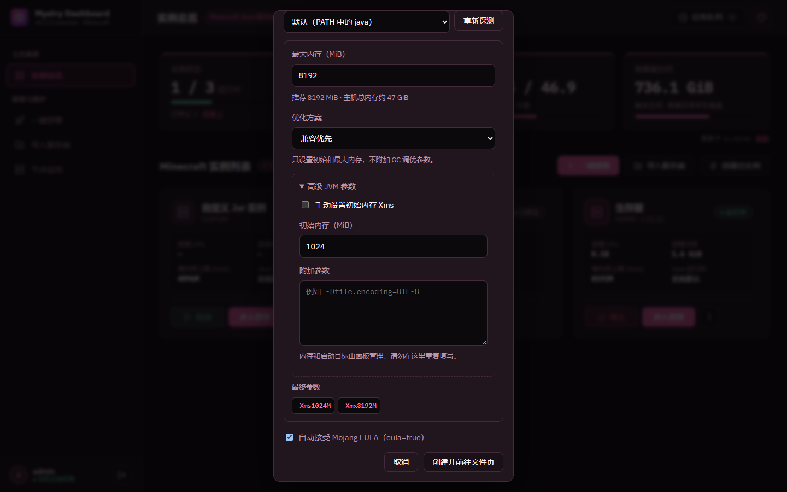

| 控件 | 说明 |
|------|------|
| 最大内存（MiB） | 推荐约为本机内存 25%，按 512 MiB 取整，通常 2–8 GiB，并为系统留至少 2 GiB |
| 优化方案 | **兼容优先**：只要内存，Xms 自动取 `min(1 GiB, Xmx)`。**G1 均衡**：需已识别 Java 8/17/21。**Paper Aikar**：仅 Paper + 上述 Java，且强制 Xms=Xmx；低于 6 GiB 会警告。**自定义**：不附加预设 |
| 官方来源链接 | Paper Aikar 等预设显示冻结版本、复核日期和来源 |
| **高级 JVM 参数** | 展开手动 Xms 和附加参数 |
| 手动设置初始内存 Xms | 勾选后才能改初始内存 |
| 附加参数 | 不要重复填 `-Xms`/`-Xmx`、`-jar`、classpath、`nogui`、`@argfile` |
| 最终参数 | 只读预览，按 token 展示即将保存的字符串 |

导入检测到 `user_jvm_args.txt` 时，必须先选其一：

| 选项 | 说明 |
|------|------|
| 沿用检测到的参数 | 解析失败则禁用 |
| 使用面板推荐 | 按主机内存生成兼容预设 |
| 自定义配置 | 用检测结果做初值，再自己改 |

有错误级诊断时，相关「保存 / 部署 / 导入 / 启动」会拒绝。警告（内存偏高、Java 未验证、Paper 内存不足）不阻止保存。

---

## 13. 窄屏布局

约 ≤1024px：侧栏变抽屉，顶栏左侧出现菜单图标。约 ≤768px：指标卡片两列排布，实例卡片单列排布，「更多操作」在卡片内直接展开。

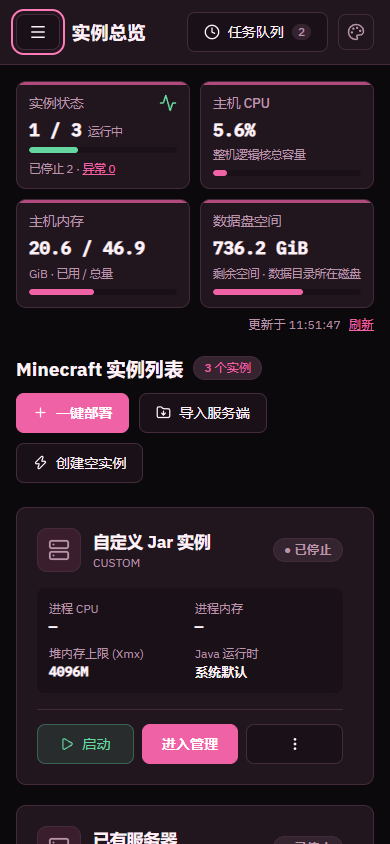


| 控件 | 说明 |
|------|------|
| 菜单图标（打开导航菜单） | 打开侧栏抽屉，主区域不可点 |
| 关闭图标（关闭导航菜单） | 关上抽屉并把焦点带回按钮；也可按 `Escape` 或点遮罩 |
| 顶栏任务队列 / 调色板 | 与桌面同一套状态，不重复轮询 |
| 卡片里的启动 / 进入管理 / 更多操作 | 与桌面同一套启用规则 |

---

## 14. 通用确认弹窗

重启、强制停止、删除实例/文件/远程节点都走同一组件，不用浏览器原生 `confirm()`。

| 控件 | 说明 |
|------|------|
| **取消** | 关闭。`busy` 时禁用；此时 Escape 和点遮罩也不能关 |
| 确认按钮 | 文案随场景变化（确认重启、确认强制停止、永久删除、创建并前往文件页…） |
| 危险确认 | 红色样式 |
| 输入实例名 | 删除托管实例时必填，必须完全一致 |

---

## 15. 数据放在哪、安全边界

| 内容 | 默认位置 |
|------|----------|
| 实例元数据 | `DATA_DIR/panel.db` |
| 实例文件 | `DATA_DIR/instances/<id>/` |
| 交接复制源 | `DATA_DIR/imports/<目录名>/`（只读源，不是运行目录） |
| 部署/导入半成品 | `DATA_DIR/.mmd-staging/<taskId>/<instanceId>/` |
| 核心缓存 | `DATA_DIR/cache/cores/` |
| 面板锁 | `DATA_DIR/.mmd-panel-lock/`（同一数据根只允许一个面板进程） |

崩溃恢复只清理 marker 匹配的 staging，**不会**因为任务结果里的 `instanceId` 去删已经注册的实例。

密钥 `JWT_SECRET`、`SETUP_TOKEN`、`LAUNCHER_TOKEN` 必须是互不相同的 64 位十六进制值。日志不应打印密钥或 ticket。

---

## 16. 按钮速查总表

按「用户在界面上能点到的东西」汇总。禁用条件以源码为准。

### 登录与壳层

| 页面 | 按钮 | 作用 |
|------|------|------|
| 登录 | 主题 | 打开三套主题 |
| 登录 | 登录 / 创建并进入 | 提交账号 |
| 登录 | 重新检查 | 重试连接面板 |
| 侧栏 | 实例总览 / 一键部署 / 导入服务端 / 节点监控（详情页另有当前工作台） | 切换主页面 |
| 顶栏 | 任务队列 | 任务中心 |
| 顶栏 | 调色板 | 主题 |
| 侧栏 | 登出图标 | 清 token |
| 窄屏 | 菜单 / 关闭图标 | 抽屉导航 |
| 任务中心 | 刷新 / 关闭 / 查看实例 | 立即刷新或失败重试；关闭面板；跳到已落地实例 |
| 主题菜单 | 6 个选项 | Mystry / Codex / Grok × 暗/亮 |

### 总览

| 按钮 | 作用 |
|------|------|
| 一键部署 | 去部署页 |
| 导入服务端 | 去导入页 |
| 创建空实例 | 打开空实例对话框 |
| 进入管理 / 名称链接 | 进详情 |
| 启动 / 停止 | 当前可执行的生命周期操作 |
| 更多操作（⋮）→ 重启实例 / 强制停止 / 删除实例 | 确认后执行 |
| 刷新（指标）/ 异常 N | 重新采样主机指标；只看异常实例 |
| 重新加载 | 列表失败时重试 |

### 部署 / 导入 / 节点

| 按钮 | 作用 |
|------|------|
| 核心类型卡片 / 立即开始自动化部署 | 选核心；入队下载安装 |
| 复制错误 / 查看详情 / 复制全部 / 关闭 | 失败排错 |
| 同机目录直接交接 / ZIP 服务端整合包导入 | 切换导入方式 |
| 刷新目录 | 重扫 `imports` |
| 复制并接管 | 入队目录复制 |
| 选择 ZIP / 上传并预检 / 确认配置并导入 / 取消并重新选择 | ZIP 二阶段 |
| 重新探测 | 重扫 Java |
| 节点删除 / 重试加载 | 仅历史远程空节点；或列表失败 |

### 实例详情

| 按钮 | 作用 |
|------|------|
| ←（返回总览） | 回列表 |
| 启动 / 停止 / 重启 / 强制停止 | 进程控制 |
| 控制台 / 文件管理 / 参数配置 / 实例设置 & JVM | 四个工作区 |
| 接管托管目录 | 仅待迁移 |
| 发送 / 常用命令快捷键 | 控制台命令 |
| 清空屏幕 / 复制日志 | 控制台显示 |
| 上级 / 上传 / 下载 / 重命名 / 编辑 / 删除 / 创建 | 文件 |
| 保存 / 关闭 / 取消（编辑器） | 文本写回或放弃 |
| 保存配置 / 保存设置 | 写 server.properties 或实例元数据 |
| 放弃修改并离开 | 未保存导航确认 |

---

## 17. 和其它文档的关系

| 文档 | 何时看 |
|------|--------|
| [快速开始](../getting-started.md) | 安装、PanelManager、便携包 |
| [分步教程](../tutorials.md) | 第一次开 Paper 服、导入、联机 |
| [使用指南](../user-guide.md) | 字段含义与排错 |
| [配置说明](../configuration.md) | 环境变量与限额 |
| [架构设计](../architecture.md) | 模块与数据流 |
| [API 参考](../api.md) | 自动化对接 |
| [AI 项目知识库](../ai/README.md) | 给开发助手用的事实与禁区 |

本文描述的是当前工作树里已经接到前端入口的能力。远程 Agent、自动备份、多用户权限等未完成项不要当成已交付功能。
