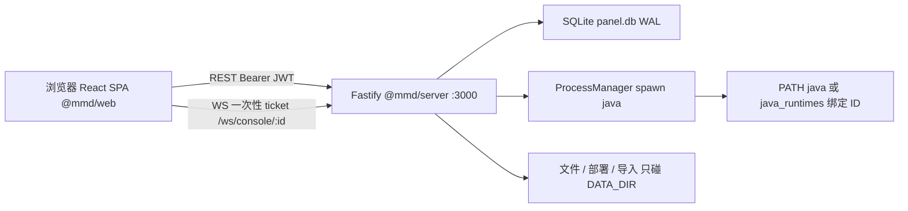

# 架构与数据边界

面板是本机一体：浏览器 SPA 调 Fastify，Fastify 只碰 `DATA_DIR`，再用本机 Java 拉起服务端进程。细节见 [docs/architecture.md](../architecture.md) 与 [docs/api.md](../api.md)。



## 包

| 包 | 路径 | 入口 |
|----|------|------|
| `@mmd/server` | `apps/server` | `apps/server/src/index.ts` |
| `@mmd/web` | `apps/web` | `apps/web/src/main.tsx`、`apps/web/src/App.tsx` |
| `@mmd/shared` | `packages/shared` | 共享类型与 schema |

生产模式由后端托管 `apps/web/dist`，默认 `http://127.0.0.1:3000`。

## 后端路由

入口挂载：`auth`、`instances`、`files`、`cores` / `import*`、`console`、`system`、`nodes`、`launcher`。健康检查：`GET /api/health`。

除 `auth/status`、`auth/setup`、`auth/login`、健康检查与本机 launcher 关闭通道外，业务路由需要 Bearer JWT。控制台：先拿一次性 ticket，再连 `/ws/console/:id`。

## 数据根

默认 `DATA_DIR=data`；便携控制器优先 `MMD_DATA_DIR`。同一 `DATA_DIR` 只允许一个面板进程（数据锁 `.mmd-panel-lock/`）。

| 路径 | 内容 |
|------|------|
| `panel.db` | WAL；表：`users` / `instances` / `tasks` / `nodes` / `java_runtimes` |
| `instances/<id>/` | 实例唯一工作目录 |
| `imports/` | 同机交接源（只读复制） |
| `cache/cores/` | 核心 jar 缓存（完整校验后原子发布） |
| `uploads/` | 上传临时文件；ZIP 预览不跨重启 |
| `.mmd-staging/` | 部署 / 导入暂存，成功后 promote |
| `.mmd-panel-lock/` | 单进程数据锁 |

Unix：`DATA_DIR` 及关键子目录 `0700`，`panel.db` `0600`；对 group/other 过开则**拒绝启动**。

## 进程怎么起

普通 jar：

```text
java <jvmArgs> -jar <jar> nogui
```
工作目录固定 `DATA_DIR/instances/<id>`。Forge / NeoForge：把规范 JVM 参数写入 `user_jvm_args.txt`，再组合面板控制的 argfile 与 `nogui`。Java 来自 PATH，或 `java_runtimes` 表中的绑定 ID（执行前复验 `-version`）。

## 任务

任务 worker 在**内存**里。并发默认 1 个 running + 2 个 queued。面板重启会把遗留 `pending` / `running` 标为失败，并尝试清理半成品实例。不能跨进程续跑。

## 外部源

| 用途 | 来源 |
|------|------|
| Vanilla | Mojang |
| Paper | `fill.papermc.io` v3 |
| Fabric | Fabric Meta |
| Forge / NeoForge | BMCLAPI2 + Maven Installer |

## 安全边界

- 路径逃逸防护（文件 API 与 zip 解压）
- 数据锁：同一 `DATA_DIR` 一个面板进程
- 原子 staging promote；未完成缓存不复用
- 子进程环境剥离面板密钥（`JWT_SECRET` / `SETUP_TOKEN` / `LAUNCHER_TOKEN` 等）

## 尚未完成

远程节点 / Agent、持久化跨进程任务 worker、通用数据库迁移框架。
